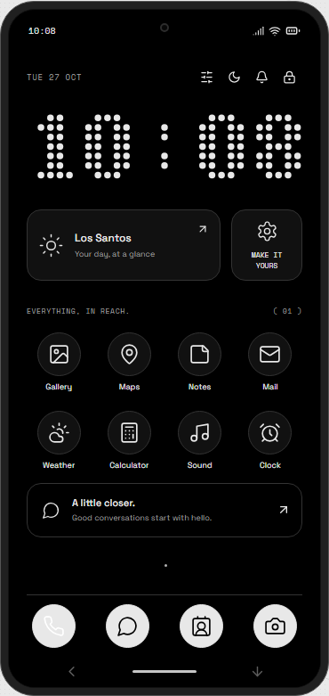
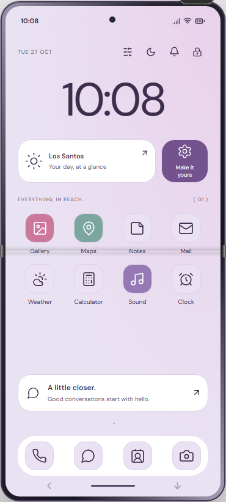
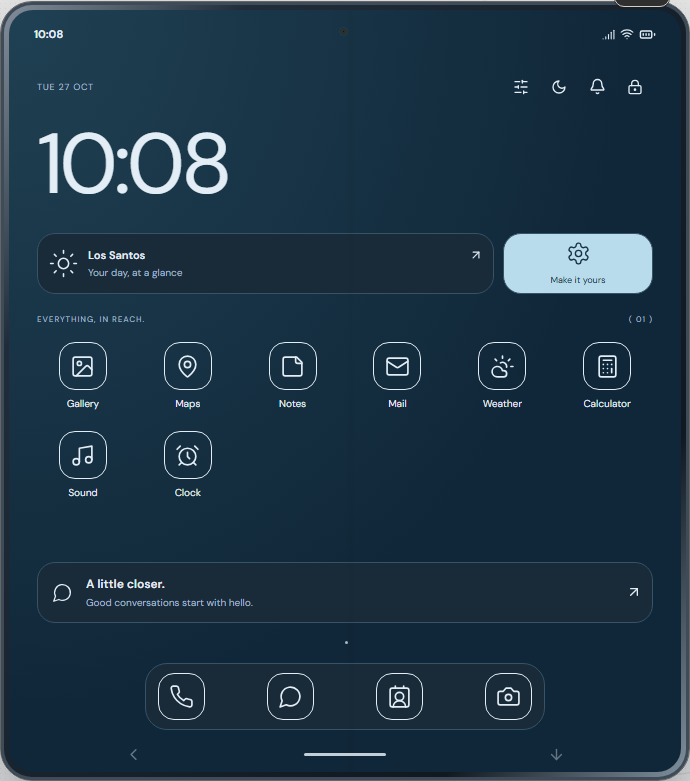
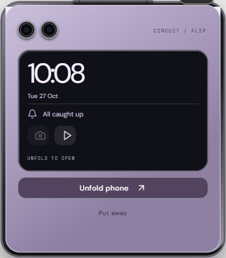
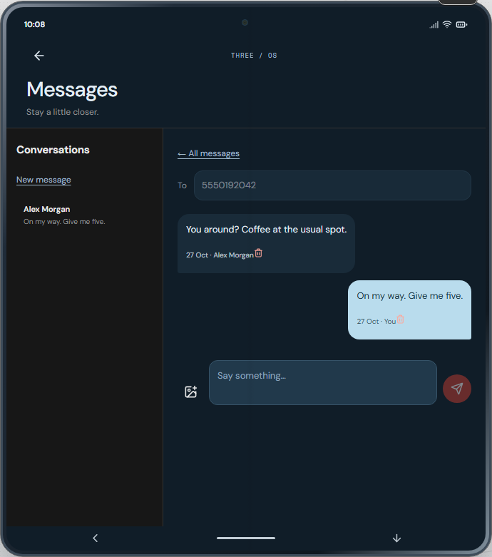

# QBPhone

**Three handsets. One connected city.**

A FiveM phone system with distinct Standard, Flip and Fold interfaces, physical handset identities, removable SIMs and cloud recovery. Built from Stevie for the custom **`[v2]` QBCore stack**.

## Meet the handsets

| Handset | Inventory item | Experience |
|---|---|---|
| **Orchard One** | `phone_standard` | Nothing-inspired Android styling, monochrome icons, dot-matrix clock, dark and light appearances. |
| **Circuit Flip** | `phone_flip` | A tall inner display and a closed cover screen for the clock, notifications, voice calls, local music controls and camera preview. |
| **Atlas Fold** | `phone_fold` | A complete outer phone that unfolds into larger app layouts, including conversations beside the selected chat and expanded Settings. |

Each handset has its own visual identity, with coordinated colors across the launcher, apps and Settings. Legacy `phone` items convert to the Standard model.

<p align="center"><em>Browser previews using demonstration data.</em></p>

| Orchard One | Circuit Flip | Atlas Fold |
|:---:|:---:|:---:|
|  |  |  |

<details>
<summary>Flip cover and expanded conversations</summary>

| Circuit Flip · closed | Atlas Fold · Messages |
|:---:|:---:|
|  |  |

</details>

## What's included

- **Calls and video:** pma-voice audio, accepted WebRTC video upgrades, in-game selfie/rear cameras, mute and hang-up.
- **Everyday apps:** Contacts, Messages with photo attachments, Camera, Gallery, Maps, Mail, Notes, Weather, Calculator, Clock and Sound.
- **Personal security:** optional PINs, simulated character-based Face ID with a backup PIN, cloud backup/restore and recovery codes.
- **Physical ownership:** multiple handsets, one selected phone, removable SIMs and persistent serials that stay with the inventory items.
- **City services:** configured NPC and authorised business counters, handset/SIM sales, SIM replacement, account recovery, resale and public/private Wi-Fi.
- **Legacy integrations:** supported `qb-phone` mail events and exports, offline system mail, one-use Accept actions and informational transaction notes.

### Your handset, SIM and account

The **handset** carries its local content, screen lock and cloud login. The **SIM** carries the phone number and routes new calls and texts. The **cloud account** backs up contacts, messages, photos and preferences for restoration on another handset.

Moving a SIM does not grant access to the previous handset's conversations or cloud account. Replacing a stolen SIM keeps the number and permanently revokes the old SIM. Without an active SIM, local apps remain available and cloud services can use configured Wi-Fi.

System Mail is character-owned, so job offers, billing messages and activity notes stay private when a handset is traded.

## Requirements

Use the resource names below. The phone integrates with the custom `[v2]` APIs, including the `PhoneItemTransaction` gateway that `kora_inventory` already provides.

| Resource/service | Used for |
|---|---|
| `kora_lib` | Shared helpers, interactions and callbacks |
| `kora_sql` | Database access and tracked migrations |
| `kora_core` | Character identity, shared items, jobs and money |
| `kora_inventory` | Physical handset/SIM ownership and locked inventory changes |
| `kora_theme` | Shared theme runtime and client bridge |
| `pma-voice` | Call audio |
| `screenshot-basic` | Saved in-game photos |
| **Fivemanage** | Saved photo and message-media hosting |

Live video travels through WebRTC, directly or through your configured TURN relay. It does not use Fivemanage as a streaming service.

## Installation

### 1. Install the resource

Place this resource in your server's resources folder and name its directory **`kora_phone-stevie`** (or **`kora_phone`**). The inventory gateway only accepts those two resource names.

The current `kora_inventory` already supplies `PhoneItemTransaction`, which handles handset binding, SIM exchange and resale through inventory authority. Nothing needs to be copied into the inventory resource, and no companion file ships with this resource. Do not replace `kora_inventory/server.lua` with an older copy.

Keep one phone provider enabled. This resource and the legacy `kora_phone` resource both provide `qb-phone` and the `kora_phone` export identity, so they are mutually exclusive: stop the previous phone before starting this replacement.

### 2. Choose the database setup

| Your database | What to do |
|---|---|
| **Fresh installation** | Leave `Config.Server.AutoMigrate = true` and let startup create the schema. If you prefer a manual import, import **[qbphone.sql](qbphone.sql)** once before startup. |
| **Existing Stevie/QBPhone installation** | Back up the database and inventories together, then use automatic migrations. Do not import the fresh-install master over existing phone tables. |

Keep automatic migrations enabled after a fresh manual import so startup adopts the schema history. The numbered files in `migrations/` are internal upgrade history and must ship with the resource.

Startup writes `migration-report.json` before legacy identity conversion. Unknown registering characters, invalid legacy numbers or malformed settings stop conversion for review. Existing numbers and supported content use resumable claims; characters without handsets do not receive duplicate phones or subscriptions.

See [deployment, migration and rollback](docs/three-handsets.md) before upgrading an existing server.

### 3. Configure your city

| File | Settings |
|---|---|
| [config/handsets.lua](config/handsets.lua) | Models, shop stock/prices, business jobs, counter locations, SIM-swap rules and Wi-Fi hotspots |
| [config/server.lua](config/server.lua) | Media provider, limits, automatic migrations, STUN and video configuration |
| [config/client.lua](config/client.lua) | Phone command/keybind, death restrictions and notification sound |

Circuit Mobile counters are preset at the Digital Den doors (Vinewood, Mirror Park, Sinner St) and Alta St; add more entries under `shops` for other stores. Replace the example shop coordinates, business job names and hotspot settings for your server. SIM swapping supports `player`, `shop` or `both`; the default is `both`.

`Config.ConsumeSimOnInstall` (default `true`, in `config/handsets.lua`): inserting a SIM moves its item into the phone so exactly one SIM item leaves the inventory, and removing it returns the same item with its number. The inventory gateway does the move; the phone re-checks the result and corrects it through `kora_inventory` `RemoveItem`/`AddItem` if an older `kora_inventory` left the SIM loose or lost it. Set `false` to skip the re-check.

### 4. Add your server configuration

Set secrets **before** starting the resources. Keep the PIN pepper stable between restarts and include it in your secure server backups.

```cfg
set qbphone_pin_pepper "REPLACE_WITH_A_LONG_RANDOM_SECRET"
set kora_fivemanage_token "YOUR_FIVEMANAGE_TOKEN"
set qbphone_workshop_wifi_password "YOUR_PRIVATE_HOTSPOT_PASSWORD"

ensure kora_lib
ensure kora_sql
ensure kora_core
ensure kora_inventory
ensure kora_theme
ensure pma-voice
ensure screenshot-basic
ensure kora_phone
```

<details>
<summary><strong>Optional TURN relay for video calls</strong></summary>

Add these alongside the convars above when using a TURN service that supports time-limited REST credentials:

```cfg
set qbphone_turn_urls "turn:YOUR_TURN_HOST:3478"
set qbphone_turn_secret "YOUR_TURN_REST_SHARED_SECRET"
```

STUN servers are configured in `Config.Calls.Video.IceServers` in `config/server.lua`. Keep API tokens and shared TURN secrets server-side.

</details>

## Using the phone

Use a handset from inventory, press **M**, or run **`/phone`** to open the selected handset. Players can visit a configured counter to buy their first phone without already owning one.

Settings is organised into **Appearance**, **Connections**, **Cloud account**, **Privacy & security**, **Sound & alerts**, and **About & resale**. Insert or remove SIMs, connect to Wi-Fi, set a PIN, enrol Face ID, and manage cloud recovery there. Save the cloud account ID and recovery code shown during registration.

| Action | Result |
|---|---|
| Close the Flip during a video call | Video pauses; voice continues. Reopening restores video. |
| Fold or unfold the Fold during a video call | The call moves between outer and inner displays without reconnecting. |
| Put any handset away | The call ends. |
| Select another handset | Any active call ends and the selected handset changes. |
| Prepare a handset for normal resale | Remove its SIM and perform an unlocked factory reset first. Cloud backups are preserved. |

## Legacy qb-phone support

Server integrations can keep using the supported `qb-phone` identity. For example, from a trusted server script:

```lua
exports['qb-phone']:sendNewMailToOffline(citizenId, {
    sender = 'Job Office',
    subject = 'Delivery offer',
    message = 'A delivery is waiting for you at the depot.'
})
```

Mail can arrive before the character owns a phone. Trusted server deliveries can include one-use Accept actions; the browser cannot nominate an event. Transaction notes appear under **Mail → Activity** and never change player balances.

See [legacy events, exports and data adoption](docs/legacy-compat.md) for the complete supported surface.

## UI development

The repository includes built NUI assets. To work on the interface from a source checkout:

```sh
npm ci --prefix web
npm run dev --prefix web
```

The standalone preview uses demonstration data. Voice, game cameras, inventory and hosted media require the FiveM server. Rebuild before deploying frontend changes:

```sh
npm run build --prefix web
```

## Scope and deployment status

The launch interface includes the apps listed above. Legacy group history remains readable; the inherited social, banking, job and marketplace interfaces remain outside the launch UI.

Battery, physical damage, account-based Wi-Fi calling and technician crafting/wiping/SIM-hacking gameplay are deferred.

Before production deployment, verify native calls/video, provider uploads and database migration/rollback on an isolated copy of your server. Shop locations, permissions and hotspot routing buckets must match your setup.
